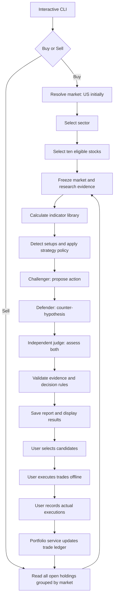

# Stock analysis CLI — US first, India next

Planning date: 10 October 2026. Status updated 1 November 2026: the Phase 1 data/CLI foundation is implemented with PostgreSQL. Fixture acceptance and live-sector qualification are separate gates; live qualification remains incomplete. Technical analysis and agent debate are planned subsequent phases. See [Phase 1 verification](docs/phase-1-verification-2026-11-01.md) and the [Phase 2 handoff](docs/phase-2-handoff.md).

## Confirmed scope

- Local CLI for US equities, targeting swing trades lasting days to weeks.
- Initial release enables the US market only. Design shared components and storage for a later India release without assuming US calendars, symbols, currency, or provider coverage throughout the application.
- AWS Bedrock is the selected LLM provider. Massive is the selected initial US price/volume provider, starting with Stocks Basic under the free-first preference. Supplementary research/classification services remain undecided; pay only for verified essential gaps and budget Bedrock usage separately.
- Buy: choose a sector, analyze ten stocks, debate each stock, and display qualifying candidates.
- Sell: analyze every open portfolio holding, debate each stock, and display potential exits.
- Three agent roles: challenger proposes the action, defender presents the counter-hypothesis, independent judge evaluates both.
- For each stock, calculate the configured trend, momentum, volatility, volume, and price-action library; use strategy-specific rules to determine which observations support a decision.
- Save every analysis report to a file, including runs with no qualifying candidates or partial failures.
- Execution happens offline. Update holdings only after the user explicitly confirms executed trade details.

Proposed initial boundaries: single user, long-only US stocks quoted in USD, daily bars with weekly context, on-demand scans. India support will add its own market configuration and INR-denominated instruments. Selling means reducing an existing holding. Intraday trading, shorting, broker order submission, and multi-user hosting are outside the initial scope.

## Architecture decision

Build one Python application with clear internal modules. The CLI calls application services; services coordinate market-data adapters, deterministic calculations, agent workflows, persistence, and reporting. Keep portfolio writes outside the agent workflow.

Resolve a versioned MarketContext before each scan and pass it explicitly through those modules. Indicator formulas and the three agent roles are shared; market configuration supplies provider routing, session calendars, currencies, universe eligibility, sector mappings, benchmarks, and strategy parameters.



### Proposed stack

- Python with Typer for commands and Rich for terminal output, progress, and prompts.
- LangGraph is proposed for the Phase 3 agent workflow, per-stock subgraphs, and persistent checkpoints. Phase 1 uses explicit collection/resume plans persisted in PostgreSQL. Select the LangGraph checkpoint backend during Phase 3; domain records remain in PostgreSQL.
- Pydantic schemas at provider and agent boundaries. LLM responses must validate before downstream use.
- pandas/NumPy for deterministic feature calculations; choose and pin a maintained indicator implementation during the technical spike, with formula conventions recorded.
- PostgreSQL 18 with SQLAlchemy and Alembic for portfolio and analysis records. Use short write transactions and a database-scoped advisory lock to coordinate application writers. Local Docker Compose supplies the development server.
- An LLMProvider interface implemented by AWS Bedrock, with configurable Bedrock models per role. LangGraph owns workflow execution; Bedrock supplies model inference. A different judge model within Bedrock can be evaluated later.
- Markdown reports for reading, JSON for structured replay and downstream use, and compressed evidence snapshots for auditability, subject to provider retention rights.

Why LangGraph: the process has a fixed dependency order, conditional failures, and resumable work. Its checkpointers persist workflow state; explicit domain persistence still handles financial records. This is a design choice, not a requirement that agents converse indefinitely. [LangGraph persistence](https://docs.langchain.com/oss/python/langgraph/persistence)

Typer and Rich fit a command-driven application with interactive terminal output. Keep a simple numbered menu for the initial release; a full-screen terminal UI can be added later. [Typer](https://typer.tiangolo.com/), [Rich](https://rich.readthedocs.io/en/stable/)

### AWS Bedrock integration

Use the AWS SDK for Python through a BedrockLLMProvider, targeting the Converse API for supported models. Converse provides a common message interface and optional tool use. Keep model-specific capabilities behind the adapter and validate outputs with the application's schemas. [AWS Converse documentation](https://docs.aws.amazon.com/bedrock/latest/userguide/conversation-inference.html)

Configure AWS region, credential profile/role, model or inference-profile ID per agent role, inference parameters, timeouts, and token/cost budgets. Use the SDK credential chain; do not store AWS secrets in configuration or reports. Verify model access, region availability, structured-response/tool support, and invocation quotas during setup. Record selected model IDs, region, request IDs, and reported usage with each assessment. Persist local workflow checkpoints independently of Bedrock. Model selection and cost ceilings remain open; no AWS resources or subscriptions are provisioned by this plan.

## CLI behavior

The initial screen presents Buy and Sell first, with Portfolio, Record offline trade, Reports, and Exit as secondary actions. Display the active market. The first release defaults to US without an extra market-selection step. Once India is enabled, Buy asks for market before sector, using the last choice as a visible default. Sell defaults to all open holdings, grouped by market, and offers an explicit market filter.

### Buy flow

1. Resolve the market, then select a sector from its configured mappings: Technology, Financials, Health Care, or another supported sector.
2. Display the market, analysis cutoff, data feed, currency, strategy version, and the ten selected companies with their listing venues.
3. Fetch common market/sector context once; build one evidence packet per stock.
4. Display progress per stock through challenger, defender, and judge.
5. Save the report. Display only approved buy candidates in the primary shortlist, with a separate explanation of watch/reject/insufficient-data outcomes.
6. Let the user inspect both hypotheses, the indicator breakdown and its role in the verdict, proposed entry zone, invalidation level, target scenario, and risks.
7. Selecting a candidate creates an optional trade intent. It does not create a holding.
8. After an offline purchase, collect actual symbol, quantity, fill price, execution time, and fees; show a confirmation summary and record the execution.

The report covers all ten selected stocks even when the approved shortlist is empty. If fewer than ten eligible stocks exist, show the shortfall explicitly and analyze those available. Do not fabricate substitutes or imply broader sector coverage.

### Sell flow

1. Load every instrument with positive open quantity; an empty portfolio returns a clear message. Apply a market filter only when explicitly requested. For a future portfolio spanning markets, partition analysis by MarketContext and display each partition's own cutoff, status, and currency.
2. Analyze all open holdings, even when there are more than ten. Batch work under the configured concurrency limit.
3. Attach the entry thesis, original invalidation conditions, lots, and current exposure to each evidence packet when available.
4. Challenger argues for an exit; defender argues for holding or an alternative conditional exit; judge evaluates the disagreement.
5. Save the full report and display sell candidates separately from hold and insufficient-data outcomes.
6. Selecting Sell creates an intent. After the offline execution, ask for actual quantity, price, execution time, and fees.
7. Record a partial or full sale. A partial sale reduces the position; a full sale closes it while retaining its history.

Support importing existing holdings and recording trades that were made independently of a recommendation. Recommendation links are optional provenance, not a prerequisite for recording reality.

Proposed command surface, alongside the default interactive menu:

```text
stock-analyser
stock-analyser scan buy --sector technology
stock-analyser scan buy --market US --sector technology
stock-analyser scan sell
stock-analyser scan sell --market US
stock-analyser portfolio
stock-analyser trade record
stock-analyser report show <run-id>
stock-analyser run resume <run-id>
```

`--market IN` becomes available only after the India adapter and configuration pass their release checks. Unsupported markets return a clear error; never silently substitute US data. A future sell scan spanning markets produces child runs and a parent summary linking their reports, including any failed or unavailable market partitions.

## Market portability

### Configuration and adapter boundaries

Define a MarketRegistry with enabled markets and versioned MarketConfig records. Start with one enabled US configuration; reserve India as a future integration, not an operational option. Do not build an additional service or duplicate the analysis pipeline for India.

Each configuration supplies:

- Market ID, supported exchanges/listing segments, currency defaults, display timezone, and provider routing/capabilities.
- Exchange-specific session calendars, regular versus special-session handling, bar-completion rules, and data-publication grace periods. Calendar exceptions come from maintained sources, not hard-coded weekday assumptions.
- Eligible security types, listing selection, sector taxonomy mappings, broad-market and sector benchmarks, and research/filing sources.
- Liquidity thresholds expressed in the listing's currency, history requirements, volume-coverage policy, and strategy configuration overrides.
- Versioned instrument constraints and event/risk flags where supported, such as price increments, quantity increments, trading restrictions, price bands, and suspensions. Their actual values must be verified during each market integration.
- Corporate-action mappings and an extension point for itemized execution fees/taxes. Store confirmed amounts; automatic jurisdiction-specific tax calculations remain out of scope.

Keep ProviderCapabilities separate from MarketConfig: an exchange, market, or benchmark being configured does not imply the selected provider supplies its history, corporate actions, news, or point-in-time universe. Missing required capabilities block the affected scan with an explanation.

### Instrument identity and venue coverage

Use immutable internal security and instrument IDs, never bare ticker text as database keys. A security identifies the underlying issue; an instrument identifies its listing/series on a venue. Store market ID, venue identifier, local symbol, security type/series, quote currency, and effective-dated provider symbol mappings; preserve ISIN or other external identifiers when available. Historical symbol changes must not create a new holding accidentally.

For the future India integration, NSE and BSE are prospective venue scopes to verify when choosing a provider. Listings of the same security on different venues need separate price/volume evidence. Do not add venue volumes or concatenate price series implicitly. Configure one analysis listing per security for sector screening, so ten stocks means ten distinct securities rather than duplicate listings. Keep holdings/executions tied to their recorded instrument; cross-venue reconciliation requires an explicit mapping and auditable action.

US consolidated feeds and individual-venue feeds also need explicit coverage metadata. A listing venue and the set of venues included in a price/volume feed are different fields.

### Currency and time isolation

Store every monetary value with its ISO currency code, including prices, cost basis, fees, and P&L. Keep USD and INR totals separate. A future optional base-currency view requires a separate FX provider, timestamped rates, and a declared conversion policy; it must not rewrite original executions or silently sum different currencies.

Derive daily/weekly bars and staleness from the instrument's exchange calendar. Use UTC for instants and the market's local session date for bar membership. Each market partition resolves its own latest completed session under the same requested analysis time; never force US and India onto an assumed common closing date.

Use market-appropriate benchmarks and the same return/currency conventions within each comparison. Evaluate strategy thresholds and any evidence scores separately by market; US performance or score calibration does not establish India performance. Agents receive market and venue context explicitly and cannot assume US benchmarks, events, or terminology for every stock.

## Data and sector universe

### Provider boundaries

Define replaceable interfaces for PriceDataProvider, UniverseProvider, ResearchProvider, CorporateActionsProvider, MarketCalendarProvider, and LLMProvider. Market-data requests use resolved instrument IDs and MarketContext; adapters translate these to provider symbols. Provider responses normalize into common schemas while retaining native source fields and coverage metadata. LLMProvider remains independent of market routing.

Selected US price provider and supplementary shortlist, subject to a free-tier capability spike (India requires a separately selected and verified integration):

- Massive historical aggregates for US prices and volume. Explicitly request the adjustment policy and consume all pages. Its documented aggregates endpoint provides historical OHLCV with split-adjustment support; validate adjusted volume and session boundaries in the integration spike. [Historical aggregates](https://massive.com/docs/rest/stocks/aggregates/custom-bars)
- FMP as a candidate for sector membership, company screening, earnings calendar, and news. Its documented screener supports sector and exchange filtering. Do not assume its free plan covers the required universe or endpoints. [Screener](https://site.financialmodelingprep.com/developer/docs/stable/search-company-screener), [Earnings calendar](https://site.financialmodelingprep.com/developer/docs/stable/earnings-calendar)
- Company investor-relations releases and filing links as primary corroborating research sources when available.

Preserve feed coverage and aggregation rules for volume-based signals. Do not silently replace consolidated coverage with a single-venue feed. Verify Massive account entitlements, adjustment behavior, benchmark access, and bar availability before treating the free plan as sufficient.

Preserve fractional volume using decimal-capable storage; do not truncate or reject a bar merely because volume is nonintegral. All 14 Massive histories in the live evaluation contained fractional volume. Cross-provider reconciliation needs explicit tolerances and discrepancy flags. [Massive fractional-volume guidance](https://massive.com/knowledge-base/article/why-does-volume-return-as-a-decimal-value-from-the-aggregates-endpoint)

### Massive initial integration

Start with Stocks Basic: completed-session analysis, local caching, and a provider-wide limiter shared across all stock workers, pagination, and retries. The published free allowance is five requests/minute with two years of history; three concurrent agent workflows must not create three separate request allowances. Persist downloaded history and refresh incrementally. [Pricing](https://massive.com/pricing)

Massive's authenticated price, reference, corporate-action and standard-news endpoints passed the initial sample evaluation with the supplied key. Use it as the primary US price source and initial news-discovery source. Its standard stock-news endpoint is documented as included in all Stocks plans, updated hourly, with two years of news history on Basic. Sector classification and forward earnings coverage remain separate acceptance checks. Preserve the wider universe-selection requirement: its initial metadata and price-history download can take considerably longer than a warm-cache scan of ten stocks. [News access](https://massive.com/docs/rest/stocks/news)

Use daily features and a weekly subset whose history fits the available data. A mandatory feature that exceeds the plan's history must be reported as unavailable; do not silently shorten its lookback. Longer backtests or mandatory long weekly averages require an explicitly selected deeper-history source/plan. The key is configured locally and sampled authenticated validation is complete; subscription/billing details were not independently verified.

### Provider options reviewed on 10 October 2026

Prices below are published personal-use plan indications in the stated currency, not a verified checkout quote or proof of endpoint access. Massive's sampled authenticated results are recorded below; the other paid-provider accounts have not been tested.

- **Alpaca — alternative US price/volume provider.** Basic is free, with 200 historical calls/minute and a restriction on the latest 15 minutes; Algo Trader Plus lists USD 99/month. Retain as an alternative for later evaluation, not an automatic fallback. Real-time consolidated data is not a prerequisite for this swing-trading design. [Plans](https://docs.alpaca.markets/us/docs/about-market-data-api)
- **Massive — selected initial US data provider.** Free Stocks Basic lists end-of-day data, two years of history, reference data/corporate actions, and five calls/minute. Starter lists USD 29/month billed monthly, five years of history, and delayed data. The free history window may constrain weekly warm-up and longer backtests; screening a whole sector also costs more requests than analyzing the final ten. [Pricing](https://massive.com/pricing)
- **FMP — reference/research candidate.** Basic lists 250 calls/day with symbol/endpoint restrictions. Starter lists USD 19/month billed annually and includes financial news; Premium lists USD 49/month billed annually and adds corporate calendars. These annual-billing equivalents require annual payment. Verify sector-screening and future earnings access before choosing a tier; free access is not a complete research guarantee. [Pricing](https://site.financialmodelingprep.com/developer/docs/pricing)
- **SEC EDGAR plus company investor-relations releases — primary research supplement.** SEC submission and XBRL APIs require no API key. They provide filings and reported facts, not a complete forward earnings calendar, news wire, or sector screener. [SEC APIs](https://www.sec.gov/search-filings/edgar-application-programming-interfaces)
- **Alpaca news — additional US research candidate.** Its documented historical news endpoint provides Benzinga-sourced articles. Test account access, source timestamps, symbol coverage, and retention/LLM-use rights; do not infer news entitlements from price-data entitlements. [News documentation](https://docs.alpaca.markets/us/docs/historical-news-data)
- **Twelve Data — cross-market candidate.** The free tier lists eight API credits/minute and 800/day. Its exchange directory lists NSE and BSE end-of-day coverage at Grow or above, so free US access does not imply free India coverage. Paid pricing varies with credit capacity; confirm the selected tier and required research datasets before purchase. [Pricing](https://twelvedata.com/pricing), [India coverage](https://twelvedata.com/exchanges?country=India)
- **Upstox — future India candidate to test first under the free-first preference.** Its Analytics Token is documented as free, read-only, and valid for one year, supporting historical data, market information, fundamentals, and news. Requires account/token setup. Verify symbol/venue coverage, history adjustments, endpoint quotas, and research completeness. [Analytics Token](https://upstox.com/developer/api-documentation/analytics-token/), [Historical candles V3](https://upstox.com/developer/api-documentation/v3/get-historical-candle-data/)
- **Zerodha Kite Connect — future India paid alternative.** Connect lists INR 500/month including historical candles and live streaming. The free Personal tier lists order/portfolio features rather than this data package. Consider it if its data meets the requirements and account access is convenient. Use only data APIs in this application. [Kite pricing](https://zerodha.com/products/api/)
- **Tickertape — supplementary research/screening candidate, integration unverified.** The user clarified that “stockticker” refers to Tickertape's US stocks page. It provides US stock pages and a US screener alongside Indian-market tools. No official public developer API was verified in this review. The inspected community MCP integration explicitly documents reverse-engineered, undocumented endpoints, so it is not evidence of an officially supported API. Manual cross-checks are possible; automated integration would need verified access, history/adjustment coverage, stability, and applicable usage rights. It is not selected as the application's primary feed. [Tickertape US stocks](https://www.tickertape.in/us-stocks), [Community integration's own API notes](https://github.com/sreerajkrishnank/tickertape-mcp/blob/main/docs/api-notes.md)

### Free-first selection process

Separate provider selection into price/volume, universe/classification, and research/events. One vendor may serve several roles, but paying for raw data does not guarantee research coverage. Prefer one primary source per role; any replacement requires a new labeled snapshot and recalculation rather than silently mixing feeds.

### Agreed history-based price-provider selection

Confirmed after the live evaluation on 10 October 2026: Massive is the default US price source; yfinance is the approved alternative when mandatory history exceeds the configured Massive account's available coverage. This is an explicit capability-based routing policy, applied before evidence collection, rather than a silent fallback on network errors. The configured policy does not require a new user confirmation for each stock.

1. Derive required history separately for daily and weekly features, including initialization/warm-up and completed-bar requirements.
2. Select Massive when its verified capabilities meet those requirements.
3. If mandatory history exceeds that coverage—for example, five years of weekly history with the currently planned Massive Basic coverage—select yfinance for that stock's price analysis. Validate actual history for the particular instrument; support for one ticker is not a guarantee for all tickers.
4. Fetch both daily and weekly price evidence from the selected source, using a consistent adjustment policy and session cutoff. Use compatible benchmark history from the same price source for relative-price calculations. Recalculate every affected indicator in a fresh snapshot; do not splice Massive daily prices into a yfinance weekly history or reuse indicators from the prior source.
5. If neither approved source meets mandatory history and quality requirements, mark the stock unassessable and state why. Do not shorten required lookbacks. An unavailable optional feature remains explicitly unavailable under the configured strategy policy.

Research routing is independent: Massive can still supply news when yfinance supplies prices. Reports record the selected price provider, selection reason, requested/returned history, timeframes, adjustment basis, cutoff and quality findings. Account capability changes are configuration inputs; the rule must not permanently assume that all Massive plans have a two-year limit.

Evidence limit: the evaluation returned 261 weekly rows over five years for MSFT only. Weekly aggregation, complete-week boundaries and other symbols still need validation. This rule is an agreed architecture decision; the application router has not yet been implemented.

### yfinance evaluation

Add yfinance to the free-first shortlist for supplementary metadata/research, sector discovery, historical comparisons, and a possible separately selected prototype price source. Massive remains the selected primary US price provider. yfinance documents price-history downloads, corporate actions, news, earnings dates, sector/industry classes, and screening. [API reference](https://ranaroussi.github.io/yfinance/reference/index.html)

Its EquityQuery supports region, sector, and exchange filters, including US and India region values. Test full pagination, listing types, classification mappings, and result completeness before using it as the dynamic sector universe; a sector's displayed top companies are not the entire universe. Actual availability varies by symbol and dataset. [EquityQuery](https://ranaroussi.github.io/yfinance/reference/api/yfinance.EquityQuery.html)

The documented public interface belongs to the Python library. The project states that it is not affiliated with or endorsed by Yahoo, is intended for research/education, and directs users to Yahoo's terms for data-use rights, describing the Finance API as personal-use oriented. The package's open-source license does not independently license the underlying data. [Project README](https://github.com/ranaroussi/yfinance)

An experimental adapter should pin the library version, cache responses, bound request concurrency/retries, and surface upstream failures or missing values. Explicitly set adjustment, corporate-action, timezone, and repair options instead of inheriting defaults. The download API currently defaults to automatic OHLC adjustment; validate its split/dividend basis against Massive before comparing or substituting series. A provider switch creates a fresh snapshot and recalculates all affected indicators. [Download parameters](https://ranaroussi.github.io/yfinance/reference/api/yfinance.download.html)

Preserve source responses and transformation metadata when testing price repair; the documented repair process can modify erroneous prices or dividend adjustments and can produce false positives. Validate earnings-date freshness and estimated/confirmed status separately. Longer price history does not imply point-in-time sector membership or a historical news archive. [Price repair](https://ranaroussi.github.io/yfinance/advanced/price_repair.html)

### Initial live evaluation results — 10 October 2026

The isolated [provider evaluation](evaluation/REPORT.md) completed 51 main yfinance probes, five targeted follow-ups and, after the user supplied a key, 25 Massive probes using 27 paced HTTP requests. It is separate from application implementation. All 27 Massive requests returned HTTP 200, without retries, in about 5 minutes 18 seconds.

Massive returned 499 daily bars for each of the ten US stocks and four benchmark ETFs over 14 October 2024–9 October 2026, with all expected sessions and no structural OHLCV failures. On shared dates, the largest close-price difference from yfinance was 0.005175%; one volume observation differed by slightly over 1%, with its cause unresolved. All 84 latest-session diagnostic trend/momentum flags agreed; this is not proof of historical strategy equivalence. XLK split-adjusted prices and volumes matched the expected factors, eight AAPL dividend dates/amounts matched yfinance, and a two-page AAPL bar request reproduced the full-history subset exactly. Massive news returned five AAPL, five JPM and three JNJ items; complete coverage and factual accuracy were not established. SIC classifications and sampled common-stock pagination were accessible.

The yfinance-specific findings remain:

- **US daily prices:** ten stocks and four benchmark ETFs each returned 501 daily rows for 10 October 2024–9 October 2026, with no missing expected US sessions or structural OHLCV failures. AAPL adjustment consistency and NVDA's known split event passed the sampled checks. This supports a guarded prototype, not a claim of independently verified price accuracy or long-term reliability.
- **Universe/classification:** all 13 stock profiles supplied sector/industry metadata. Two screener pages per sector returned 50 distinct symbols, but screener rows omitted sector/industry and included listings outside the intended common-stock universe. Require profile enrichment and explicit exchange/security-type eligibility; full universe pagination and completeness remain unverified.
- **Research:** ticker-news calls returned empty lists for four symbols. Search news returned five items each for three US stocks and zero for RELIANCE.NS. Use explicit relevance, freshness, deduplication and coverage checks; missing articles do not mean no news.
- **Earnings:** AAPL calendar and earnings-date interfaces disagreed by one day. Preserve conflicting values and source timezones, normalize to the exchange date, and corroborate relevant events. An unresolved earnings-risk gate requires abstention where that gate is mandatory. Do not infer confirmed dates from nonempty responses.
- **India:** two NSE histories returned 496 rows each with two zero-volume rows; no NSE calendar validation was performed. RELIANCE.BO returned one row on both date-range and period requests. India remains unqualified.

yfinance is approved for the explicit history-based price-selection policy above and remains an optional metadata/discovery source. It is not accepted as the sole research feed or an unrestricted outage fallback. Capability checks must distinguish successful transport from usable, sufficiently complete evidence for each endpoint and instrument. See the report for reproducible scripts, saved evidence and remaining validation: full sector coverage, forward earnings, publication timing, corrections and broader reliability.

### Provider validation sequence

1. Build on the passed Massive daily-bar, benchmark, split/dividend and pagination sample. Validate end-of-day publication timing, corrections and mandatory feature history under the actual deployment schedule.
2. Complete sector classification, full universe eligibility and forward-earnings validation. Massive reference/news access and yfinance's sampled interfaces have been tested, with the limitations above. Compare with SEC/issuer releases and other providers only for demonstrated gaps. Record endpoint entitlements and gaps; do not describe missing news as no news or an unknown earnings date as no upcoming earnings. Use yfinance prices under the explicit history-selection policy, not as a silent response to provider failures.
3. Budget the full sector-screening workload, benchmark requests, corporate actions, research, pagination, and retries. Cache universe metadata separately from session prices and fetch source data once for all three agents. Calculate indicators locally to avoid an API request per indicator.
4. If free universe/event coverage is insufficient, identify the smallest paid plan that closes the specific gap and its billing commitment. A manually curated sector list is an explicitly narrower prototype mode, not a silent substitute for the planned dynamic universe. Paid plans remain a decision for the user.
5. Verify that the chosen plan permits personal analysis, local report retention, and sending the necessary excerpts/data to AWS Bedrock. Store only permitted source content. Record account eligibility and supported regions as part of the provider spike.

Decision at this stage: use Massive for primary US prices and initial news discovery, with issuer/SEC corroboration and optional yfinance classification/discovery support. No additional paid provider has been justified by this sample; full universe and forward-earnings gaps still need resolution. Keep Alpaca as an alternative for later evaluation. Defer India integration until its phase, with Upstox first on the free-first shortlist. A complete zero-cost production workflow has not yet been validated.

### Selecting ten stocks

Use a versioned, deterministic policy rather than asking the LLM to invent tickers:

1. Fetch eligible active equities for the resolved market and sector. The initial US policy selects US-listed common equities and excludes ETFs, funds, OTC instruments, and ADRs. Future India eligibility and listing/series filters belong to its own policy. Deduplicate securities across listings using the configured analysis-listing rule.
2. Normalize the provider's taxonomy into the application's sector identifiers; preserve the original classification and source timestamp.
3. Apply configurable liquidity, price, and sufficient-history criteria. Proposed initial US eligibility: at least 260 completed daily bars, enough additional history for all mandatory strategy features to warm up, and a strategy-specific minimum average traded value in USD. Optional features with insufficient history remain explicitly unavailable. The future India policy uses its configured INR thresholds and locally validated history requirements.
4. Within the selected market, rank eligible stocks by trailing 60-session average traded value (price × volume under a documented calculation convention) and take ten; use instrument ID as a deterministic tie-breaker. Record currency and feed coverage. Do not compare raw USD and INR traded values in a combined ranking.
5. Save the whole screening policy, selected symbols, and exclusions with the run. Fetch enough history for every chosen indicator's warm-up.

This selects a reproducible liquid sample. It does not claim to find the ten best buys across the sector. Broader screening can be a later feature.

### Snapshot rules

- Use the latest completed session and completed weekly bars for the resolved market and exchange calendar, including holidays, early closes, special sessions, and daylight saving time where applicable.
- Store timestamps in UTC; display the relevant market's time and optionally the user's local time. Store market-session dates separately.
- Derive the history request from the indicator registry's lookbacks and warm-up requirements and the market profile's minimum. The initial US default is at least 260 completed daily bars; extend as needed. Weekly features require their own history calculation; 200 weekly bars cannot be inferred from one year of daily data. Cache keys include market, instrument, provider/feed coverage, snapshot, timeframe, adjustment policy, parameters, and implementation version.
- Use split-adjusted OHLCV consistently for technical calculations. Store raw prices and adjustment metadata as well; map proposed levels to the current trading basis.
- Use a separately defined total-return series for benchmark return comparisons if dividends are included; never mix its levels with raw trading prices.
- Validate timestamps, OHLC consistency, gaps, duplicates, volume, and corporate-action discontinuities. Distinguish a closed market from a stale provider response.
- Freeze evidence before debate. Every agent uses the same snapshot ID. New data requires a new snapshot and rerun of affected stages.
- Research items include source URL, publication time, retrieval time, excerpt or permitted stored content, and evidence ID. Missing earnings/news coverage is an explicit unknown.

## Technical signals and decision rules

Code calculates values and detects setups; agents interpret and challenge the resulting evidence. Support the full indicator library below while initially enabling a small, explainable strategy family for trend-following swing trades. Computing a feature does not automatically give it a vote in a decision.

### Indicator library

For every stock, calculate each enabled feature when sufficient valid history exists. The initial daily feature configuration covers the following library; weekly context uses an explicitly configured subset.

- **Trend:** SMA and EMA at 20, 50, 100, and 200 sessions; configured moving-average crossovers; price above/below and percentage distance from major averages; slopes; daily/weekly agreement.
- **Momentum:** RSI, MACD including signal line and histogram, Rate of Change, and stochastic oscillator including %K and %D.
- **Volatility:** ATR, ATR as a percentage of price, Bollinger Bands including width and price position, and historical volatility.
- **Volume:** average volume, relative volume, volume spikes, and rule-defined price/volume confirmation.
- **Price action:** support and resistance, breakouts, breakdowns, recent highs/lows, pullbacks, and candidate/confirmed trend reversals under explicit detection rules.
- **Risk and context:** nearby invalidation levels, distance from entry, scenario reward/risk, relative strength against market and sector benchmarks, market regime, earnings, and material company/sector events.

Use a versioned IndicatorRegistry to declare each feature's identifier, parameters, input fields, timeframe, units, output fields, minimum history, warm-up policy, dependencies, and implementation version. Persist smoothing/seed conventions, standard-deviation conventions, historical-volatility return type and annualization factor, and handling of missing data or zero denominators. SMA/EMA periods are parameters; a 20-day average is not a separate indicator family.

Each observation has a value or an explicit availability status with a reason. Never convert undefined RSI/stochastic values, zero-volume denominators, or insufficient history into a neutral or bullish signal. A missing mandatory feature blocks that strategy's candidate decision; a missing optional feature is disclosed and handled by its predefined policy.

### Price-action definitions

Price-action labels require versioned detectors, not free-form visual assertions by the agents. Specify and test these rule templates before enabling a strategy:

- **Recent highs/lows:** extrema over a configured window, stating whether the current bar is included. Breakout comparisons use prior bars only.
- **Support/resistance:** levels derived from a configured trailing window or confirmed swing pivots, with explicit touch count and level-merging tolerance. Record the contributing bars.
- **Breakout/breakdown:** a completed close beyond the prior resistance/support level by a configured percentage or ATR buffer, with explicit persistence and volume-confirmation requirements.
- **Pullback:** retracement toward a defined average or support zone within a qualifying trend, with a specified tolerance and confirmation condition.
- **Trend reversal:** a candidate change followed by a defined structure/trend confirmation. If a pivot needs right-hand bars, its evidence becomes available only after those bars close; never backdate confirmation to the pivot bar.
- **Volume spike/confirmation:** compare the completed bar's volume with a baseline of prior completed sessions, excluding that bar. Record the configured ratio threshold and corresponding price event.

Thresholds and windows belong to configuration and are evaluation hypotheses. A reported pattern must reference its detector version, input evidence, and confirmation time.

### Strategy selection and evidence grouping

An explicit pipeline runs after calculation: detect setups → apply the configured strategy profiles → produce grouped supporting/opposing evidence → run debate → enforce final gates.

Initially enable trend-following breakout and pullback profiles with their own entry and exit policies. Range/mean-reversion and reversal profiles remain disabled until separately defined and evaluated. The indicator library can still expose their descriptive features.

Define a versioned StrategyPolicy with eligible market regimes, mandatory/optional features, setup rules, entry/exit conditions, disqualifiers, group weights or caps, missing-data behavior, and explanation rules. Save the selected policy before debate. Agents may challenge its applicability but cannot change parameters or choose whichever strategy makes a stock look attractive. If several profiles are enabled, preserve their separate assessments and use a predefined conflict-resolution rule.

Treat correlated indicators as grouped evidence. Moving-average and MACD observations must not count as independent confirmations simply because they have different names. Cap overlapping contributions across groups as well as within a group. Show contradictory evidence explicitly; do not decide by a majority of bullish indicators. RSI alone must not force a buy or sell.

Every available feature remains inspectable by all three roles. Strategy selection controls scoring, not access: the defender must be able to inspect conflicting observations outside the challenger's preferred subset. Classify each feature as decisive, supporting, conflicting, contextual, unused by this policy, or unavailable, with an explanation where relevant.

For buys, require valid fresh data, a supported setup, coherent price levels, acceptable configured reward/risk, and no unresolved mandatory blocker. The judge can downgrade a setup; it cannot override failed numeric or data-quality gates.

For sells, evaluate thesis invalidation, support/trend failure, deterioration in relative strength, and the configured exit policy. Failure to qualify for a new buy is not automatically a sell. An entry-price loss or an overbought RSI alone does not establish an exit signal.

Use an evidence-strength score only if useful for ordering. Label it as a heuristic; never display an LLM's confidence as a calibrated probability of profit. Support BUY_CANDIDATE, WATCH, REJECT, SELL_CANDIDATE, HOLD, and INSUFFICIENT_DATA. Failed processing is a separate operational status, not HOLD.

## Agent workflow

The names follow the requested terminology: challenger originates the proposed action; defender challenges that action; judge is independent of both.

### Challenger

Input: frozen technical features, detected setups, grouped supporting and opposing evidence, market/sector research, strategy policy, and relevant position context.

Output: proposed action or abstention, thesis, evidence IDs, setup conditions, candidate entry/exit levels, horizon, invalidation conditions, risks, and missing evidence. For a sell, explain why the position should be reduced or exited.

### Defender

Input: the same packet plus the challenger's structured hypothesis.

Output: counter-hypothesis, strongest evidence against the proposed action, unsupported claims, alternative interpretations, and conditions under which the original thesis would become credible. Explicitly check indicator redundancy, conflicting features, regime mismatch, and missing mandatory observations. For a buy it can argue wait/avoid; for a sell it can argue hold. It can agree when the evidence warrants it and must not manufacture objections.

### Independent judge

Instantiate a fresh context per stock, with the evidence, both structured hypotheses, and the rubric. The judge has no authority to modify evidence, submit orders, or update holdings.

Output: verdict, accepted/rejected claims with reasons, resolution of each material objection, unresolved uncertainty, conditions that would change the verdict, and evidence IDs. A deterministic validator checks every referenced ID, numeric claim, level ordering, and policy gate before publishing a candidate.

“Verify” means checking traceable evidence and consistency. Agreement among agents is not evidence of future profitability, and multiple roles using one model are not statistically independent.

### Execution policy

- Default: one challenger → defender → judge sequence for each stock. Ten stocks require 30 role calls, plus any separately budgeted research summarization.
- Allow one bounded evidence-repair cycle if needed; unresolved critical gaps result in INSUFFICIENT_DATA. Never loop until agents agree.
- Run different stocks concurrently, initially at a configurable limit of three. Roles for a given stock remain sequential.
- Share market/sector research across stocks and cache provider responses by their validity period.
- Bound tool calls, tokens, elapsed time, and retry counts. Retry transient failures with backoff; malformed responses get a bounded repair attempt.
- Checkpoint completed stages. Resume against the original snapshot and policy; reanalysis with new market data creates a new run.
- Show stage progress, elapsed time, and partial failures. Do not imply live streaming prices when using completed-session data.
- Treat retrieved documents as untrusted evidence. Tools available to analysis agents are read-only and narrowly scoped; trade-recording tools are never exposed to them.

## Data contracts and persistence

Core typed objects:

- MarketContext: market/config version, calendar reference/version, venue scope, provider routes/capabilities, benchmark mapping, currency conventions, strategy profile.
- Instrument: immutable instrument/security IDs, market, venue, symbol/series, quote currency, external IDs, effective-dated provider mappings.
- AnalysisRequest: mode, market scope, sector or instrument list, horizon, requested as-of time, strategy version, portfolio revision; resolved cutoff per market child run.
- IndicatorSpec: feature ID, parameters, inputs, timeframe, units, warm-up requirements, dependencies, formula conventions, implementation version.
- IndicatorObservation: evidence ID, feature ID/version, snapshot ID, parameters, timeframe, observed/available-at times, value(s), units, availability status and reason.
- SetupAssessment: detector ID/version, strategy ID/version, confirmation time, evidence IDs, conditions passed/failed/unknown, grouped evidence, mandatory blockers, feature roles.
- EvidencePacket: snapshot ID, instrument ID, MarketContext, currency, session cutoff, feed coverage, bars reference, indicator observations, setup assessments, source records, position context, quality flags.
- Hypothesis / CounterHypothesis: structured claims, evidence IDs, proposed action, conditions, invalidation, risks.
- Verdict: decision, rationale, objection resolutions, cited evidence, gate results, heuristic score if enabled.
- TradeConfirmation: instrument/venue, side, quantity, actual price and currency, itemized fees/taxes with currencies, execution time, optional intent/run IDs, idempotency key.

Use PostgreSQL tables for securities, instruments and symbol history; versioned market configurations; universe snapshots; analysis runs and per-stock stages; evidence manifests; executed trades; corporate actions; and report artifacts. The implemented foundation links collection child runs through persisted scan configuration and derives FIFO position lots from ledger events. Add agent assessments, recommendations, and trade intents with their implementing phases. Market scope and currency fields are present from the initial schema. Keep source snapshots and bulky time-series data in files referenced by content hash.

Every analysis run records model/provider identifiers, prompt version, code version, indicator registry and detector versions, strategy configuration, data cutoff, feed, source hashes, status, timings, and token usage when reported. Persist calculated observations and setup assessments in the run's evidence snapshot, including unavailable values and reasons. Save the original structured outputs so audit does not depend on reproducing an LLM response.

### Portfolio correctness

Executed trades form the authoritative ledger. Holdings are derived from executions and explicit corporate-action records; a materialized holdings view may be maintained transactionally for convenience.

- Use decimal arithmetic and lossless decimal storage for quantities, prices, and fees. The foundation persists financial decimals as JSON strings rather than floating-point values.
- Validate execution currency against the instrument and retain fee currencies. When a fee needs conversion for cost basis, require an explicit recorded FX rate or mark that accounting result incomplete. Enforce quantity/price precision through the instrument profile without assuming all markets allow the same increments; preserve auditable overrides for verified historical executions.
- Validate positive quantity, nonnegative fees, execution timestamp, and available shares when recording a sell.
- An idempotency key prevents replay from duplicating a trade. Check holdings and write the ledger in the same transaction.
- Track multiple purchase lots; initially use a documented FIFO convention for internal cost basis and realized P&L. This is portfolio bookkeeping, not a tax-reporting engine.
- Apply splits to share quantities and per-share basis with an auditable event. Flag mergers, spin-offs, and ambiguous actions for reconciliation.
- Partial fills can be recorded separately. Trade intents can be unfilled, partially filled, filled, or cancelled; these states are separate from analysis verdicts.
- Correct recorded executions with an auditable correction/reversal mechanism rather than deleting history.
- A changed or stale recommendation does not prevent recording a real offline execution. The CLI may show its age, but actual trade records reflect what happened.

## Report artifacts and failure handling

Each run writes under `reports/<date>/<run-id>/`:

- `report.md`: readable summary, all stock outcomes, hypotheses, objections, verdicts, and sources.
- `report.json`: versioned structured results for programmatic use.
- `manifest.json`: snapshot IDs, configuration, hashes, model/prompt versions, completion status, and file references.

The report states the mode, market, instrument venues, currency, local session date/timezone, sector or portfolio snapshot, trading horizon, price basis, analysis cutoff, source coverage, benchmark mapping, market-config version, and limits. Include entry/invalidation/target scenarios where supported, but do not invent missing levels. Save rejected and unassessable stocks as well as approved ones. A future parent report spanning markets links each child report, shows separate cutoffs and currency totals, and discloses incomplete partitions; it does not present a combined confidence ranking without separate calibration.

For each stock, include an indicator breakdown with values, units, periods/timeframes, availability, and role in the verdict; detected setups and their confirmation times; selected strategy/version; supporting and conflicting evidence by group; mandatory gate results; and the judge's resolution of the defender's objections. The CLI shows a compact summary with optional details; Markdown contains the readable breakdown and JSON retains every calculated observation. An unused indicator is not an absent calculation, and an unavailable indicator is not a neutral observation.

Trade recording creates a separate execution receipt linked to the original report. It does not rewrite an old analysis into a claim that the trade happened at the suggested price.

Use temporary files followed by atomic rename. Since PostgreSQL and filesystem writes cannot share one transaction, track report status separately and make report regeneration idempotent. Do not display “report saved” until all required artifacts exist.

A provider failure for one stock yields a partial run with that failure disclosed. Exhausted agent retries never become a candidate verdict. If all stocks fail, write a failure report. If saving the report fails, retain persisted analysis and expose a retry action. Cancellation preserves completed work.

## Proposed source layout

```text
src/stock_analyser/
  cli/             # menus, commands, progress, confirmation screens
  application/     # buy/sell scan and trade-recording use cases
  domain/          # schemas, strategies, verdicts, portfolio rules
  markets/         # registry, market context, calendars, symbol/sector mappings
  providers/       # prices, universe, research, corporate actions, LLM
  analysis/
    indicators/    # registry, calculations, warm-up and availability
    patterns/      # causal support/resistance and setup detectors
    strategies/    # policy selection, grouped evidence, entry/exit rules
    validation/    # evidence checks and final decision gates
  agents/          # challenger, defender, judge, versioned prompts
  workflows/       # graph definitions, state, checkpoints, retries
  persistence/     # repositories, database models, migrations
  reporting/       # Markdown/JSON rendering and artifact manifests
config/
  markets/         # US profile first; India profile when its integration is ready
  analysis/        # indicators, detectors, strategies and market overrides
  runtime/         # model routing, budgets, provider settings
tests/             # unit, provider contract, workflow, CLI integration
```

Runtime databases, reports, caches, and credentials belong outside tracked source. API credentials come from environment variables or a local secrets mechanism and must be redacted from logs and saved requests.

## Validation and delivery phases

1. **Data and CLI foundation:** confirm US provider entitlements and sector coverage; implement market-aware contracts/schema with the US profile, Buy/Sell menus, database migrations, offline trade recording, deterministic universe selection, snapshot caching, and report skeletons.
2. **Technical analysis:** implement the full configured indicator library, registry and availability handling, causal price-action detectors, and baseline trend-following profiles with grouped evidence, benchmarks, quality gates, and separate buy/sell policies.
3. **Agent debate:** add structured challenger, defender, and judge nodes; evidence validation; budget limits; resumable per-stock runs; and readable debate reports.
4. **End-to-end workflow:** connect shortlists, intents, execution confirmations, partial sales, existing-holding imports, and report history.
5. **Evaluation before reliance:** walk-forward tests and paper observation; compare the deterministic strategy alone against the same strategy plus debate. Measure out-of-sample returns after costs, drawdown, turnover, abstention, evidence errors, consistency, latency, and model cost. Do not use agent agreement as the success metric.
6. **India expansion:** select and verify data/research providers and supported venues; add instrument/series mappings, INR metadata, calendars, sectors, benchmarks, corporate actions, and independently evaluated strategy profiles. Enable `IN` only after provider contract tests and end-to-end buy/sell/report tests pass. Reuse the indicator engine, agents, ledger services, and CLI components.

Testing priorities: known indicator fixtures and smoothing conventions; warm-up and zero-denominator cases; daily/weekly history requirements; calendar/split cases; no look-ahead in levels and pivot confirmation; volume baselines excluding the current bar; correlated-evidence caps; mandatory versus optional missing features; provider pagination; invalid or unsupported agent claims; no-candidate runs; per-stock failure; interrupted-run resume; duplicate execution confirmation; partial sells; over-selling rejection; and report-write recovery.

Compare the baseline feature subset with expanded feature groups using held-out periods and ablation tests (remove a group and measure the change). Predefine the evaluation criteria, keep parameter tuning separate from final evaluation, and retain additional decision rules only when their benefit survives out-of-sample testing. Calculating the full library does not require using every feature in scoring.

From the first release, use synthetic second-market fixtures to verify symbol collisions, distinct currencies, independent session cutoffs, and provider-routing isolation without depending on a live India integration. Before India release, add real-provider tests for exchange calendars and special sessions, duplicate listings, native symbols/series, currency-labeled reports, independent portfolio lots, corporate actions, and failure of one market partition while another succeeds.

Backtests must use data and sector membership available at the decision time, account for delistings, and simulate execution after the signal becomes available. Historical news added later cannot be injected into an earlier decision. If point-in-time research is unavailable, evaluate the technical component historically and validate research/debate prospectively.

## Decisions remaining before implementation

- Full sector-universe/classification workflow, forward-earnings corroboration and any essential paid coverage gaps. Massive key setup and sampled endpoint/history validation are complete; the initial US price-provider choice is confirmed.
- Future India venue scope and provider choice, sector/benchmark mappings, and market-specific parameters; these do not block implementing the US release behind shared interfaces.
- AWS Bedrock region, role-specific model/inference-profile IDs, account access/quotas, and maximum cost per scan; the provider choice is confirmed.
- Indicator parameters and formula conventions, price-action detector windows/thresholds, strategy gates and evidence-group caps, earnings-event policy, and liquidity filters, to be versioned and evaluated rather than treated as proven defaults.

Confirmed choices already incorporated: US first with future India expansion, AWS Bedrock for LLM inference, Massive as the initial US price/volume provider, free-first services with paid upgrades only for essential gaps, swing-trading horizon, and explicit confirmation of offline executions before portfolio updates.
